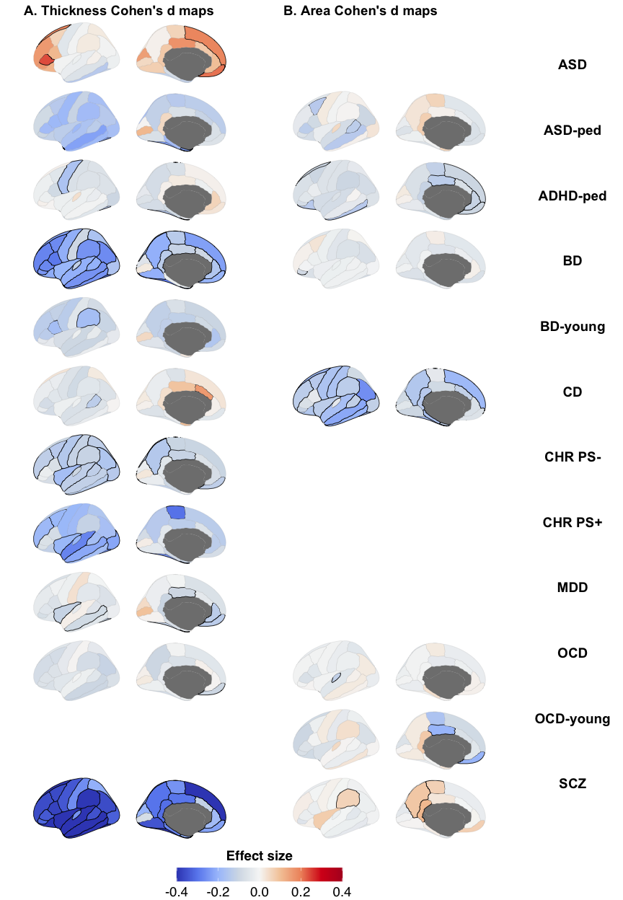
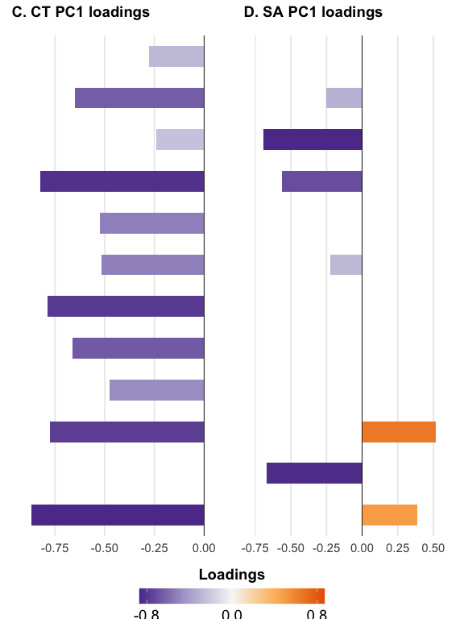
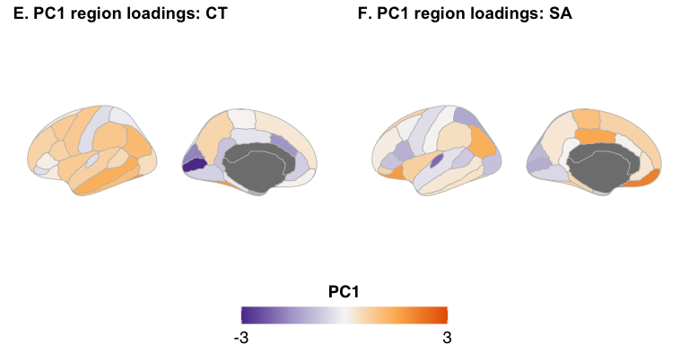
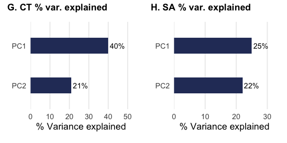
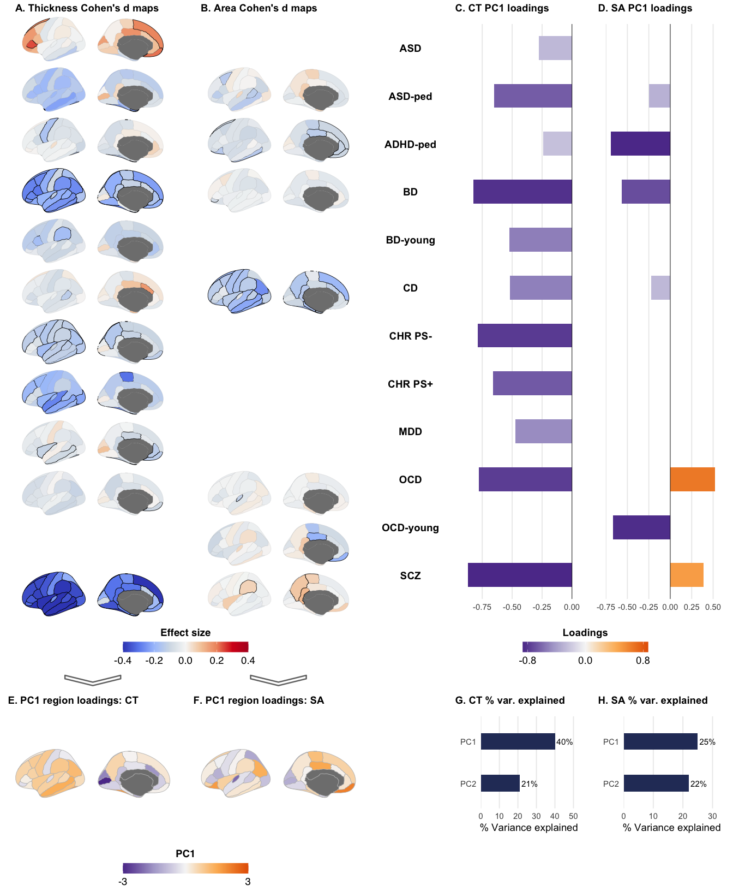

Fig4
================

## Fig. 4, statistics and panel figures A to H

Figure 4. Regional cortical alterations across neurodevelopmental and
psychiatric disorders.

Cohen’s d maps for regional cortical alterations across
neurodevelopmental and psychiatric disorders (NPDs) for A) cortical
thickness (CT); B) surface area (SA). Case-control differences were
calculated after adjusting for age, sex, and site (and total SA for SA).
FDR (q\<0.05) significant regions are shown by black boundaries. Only SA
and CT effect sizes maps with FDR significant associations for at least
one ROI are shown. C-H) Principal component analysis across regional
cortical differences. PC1 variable loadings for C) CT and D) SA. Latent
dimension map: the first principal component from the principal
component analysis (PCA) across E) CT and F) SA alterations for NPDs.
The variance explained by the first two principal components (PC1 and
PC2) for G) CT, and H) SA.

## Load data

``` r
source("Rscript_utility_functions.R")
library(patchwork)
library(cowplot)
library(grid)
library(gridExtra)

load(paste0(data_dir, "data_fig4a_es_pval_CNVs_NPDs.RData"))

## Display order and labels of the NPD groups with at least one FDR-significant region (CT or SA)
npd_order = c("ASD", "ASD-p", "ADHD-p", "BD", "BD-y", "CD", "CHRPSn", "CHRPSp", "MDD", "OCD", "OCD-y", "SCZ")
npd_labels = c("ASD", "ASD-ped", "ADHD-ped", "BD", "BD-young", "CD", "CHR PS-", "CHR PS+", "MDD", "OCD", "OCD-young", "SCZ")

df_es_CT = df_es_CT_NPDs_all[, npd_order]
df_es_SA = df_es_SA_NPDs_all[, npd_order]
```

## Stats Fig. 4A and 4B: FDR correction

``` r
## FDR across all NPD groups and regions, CT and SA together
n_NPD = ncol(df_pval_CT_NPDs_all)
p_array = as.vector(as.matrix(cbind(df_pval_CT_NPDs_all, df_pval_SA_NPDs_all)))
p_array_adj = matrix(p.adjust(p_array, method = "fdr"), nrow = 34)
df_pval_CT_adj = as.data.frame(p_array_adj[, 1:n_NPD])
df_pval_SA_adj = as.data.frame(p_array_adj[, (n_NPD + 1):(2 * n_NPD)])
colnames(df_pval_CT_adj) = colnames(df_pval_SA_adj) = colnames(df_pval_CT_NPDs_all)

df_n_FDR_regions_fig4 = data.frame(NPD = colnames(df_pval_CT_adj),
                                   n_FDR_CT = colSums(df_pval_CT_adj < 0.05),
                                   n_FDR_SA = colSums(df_pval_SA_adj < 0.05),
                                   row.names = NULL)
print(df_n_FDR_regions_fig4)
```

    ##       NPD n_FDR_CT n_FDR_SA
    ## 1     OCD        1        1
    ## 2    ADHD        0        0
    ## 3     ASD        4        0
    ## 4      BD       30        1
    ## 5     MDD        6        0
    ## 6     SCZ       33        4
    ## 7      CD        2       21
    ## 8  CHRPSp        8        0
    ## 9  CHRPSn       15        0
    ## 10  OCD-y        0        2
    ## 11 ADHD-y        0        0
    ## 12  ASD-y        0        0
    ## 13  OCD-p        0        0
    ## 14 ADHD-p        2        6
    ## 15  ASD-p        3        2
    ## 16   BD-y        2        0
    ## 17  MDD-y        0        0

``` r
df_pval_CT_adj = df_pval_CT_adj[, npd_order]
df_pval_SA_adj = df_pval_SA_adj[, npd_order]

## Maps and PCA: only NPD groups with at least one FDR-significant region for that metric
include_CT = colSums(df_pval_CT_adj < 0.05) > 0
include_SA = colSums(df_pval_SA_adj < 0.05) > 0
print(npd_order[!include_CT])
```

    ## [1] "OCD-y"

``` r
print(npd_order[!include_SA])
```

    ## [1] "ASD"    "BD-y"   "CHRPSn" "CHRPSp" "MDD"

## Stats Fig. 4C to 4H: PCA

``` r
res_pca_CT = prcomp(df_es_CT[, include_CT], scale = TRUE, retx = TRUE)
res_pca_SA = prcomp(df_es_SA[, include_SA], scale = TRUE, retx = TRUE)

## Variable loadings (correlation of each NPD group with the PC) and region scores; PC1 sign reversed
loadings_CT = rep(NA, length(npd_order))
loadings_SA = rep(NA, length(npd_order))
loadings_CT[include_CT] = -res_pca_CT$rotation[, 1] * res_pca_CT$sdev[1]
loadings_SA[include_SA] = -res_pca_SA$rotation[, 1] * res_pca_SA$sdev[1]
PC1_regions_CT = as.vector(scale(-res_pca_CT$x[, 1]))
PC1_regions_SA = as.vector(scale(-res_pca_SA$x[, 1]))

var_exp_CT = 100 * res_pca_CT$sdev^2 / sum(res_pca_CT$sdev^2)
var_exp_SA = 100 * res_pca_SA$sdev^2 / sum(res_pca_SA$sdev^2)

df_var_exp_fig4G_4H = data.frame(metric = c("CT", "CT", "SA", "SA"),
                                 PC = c("PC1", "PC2", "PC1", "PC2"),
                                 var_exp = c(var_exp_CT[1:2], var_exp_SA[1:2]),
                                 var_exp_rounded = round(c(var_exp_CT[1:2], var_exp_SA[1:2])))
print(df_var_exp_fig4G_4H)
```

    ##   metric  PC  var_exp var_exp_rounded
    ## 1     CT PC1 40.14799              40
    ## 2     CT PC2 21.25969              21
    ## 3     SA PC1 25.42523              25
    ## 4     SA PC2 22.06497              22

``` r
df_loadings_fig4C_4D = data.frame(NPD = npd_labels, loading_PC1_CT = loadings_CT, loading_PC1_SA = loadings_SA, row.names = NULL)
print(df_loadings_fig4C_4D)
```

    ##          NPD loading_PC1_CT loading_PC1_SA
    ## 1        ASD     -0.2784298             NA
    ## 2    ASD-ped     -0.6488930     -0.2492172
    ## 3   ADHD-ped     -0.2419849     -0.6913000
    ## 4         BD     -0.8231197     -0.5649710
    ## 5   BD-young     -0.5241952             NA
    ## 6         CD     -0.5170159     -0.2227454
    ## 7    CHR PS-     -0.7887227             NA
    ## 8    CHR PS+     -0.6612191             NA
    ## 9        MDD     -0.4737354             NA
    ## 10       OCD     -0.7764518      0.5191303
    ## 11 OCD-young             NA     -0.6706117
    ## 12       SCZ     -0.8677139      0.3895342

## Plot settings

``` r
coolwarm = colorRampPalette(c("#3B4CC0", "#6B8DF0", "#A9C5FC", "#D6DFE8", "#F7F7F7",
                              "#F5CBA7", "#F0946C", "#D7191C", "#B40426"))
col_PC = colorRampPalette(c("#5e3c99", "#b2abd2", "#f7f7f7", "#fdb863", "#e66101"))
panel_title_theme = theme(plot.title = element_text(face = "bold", size = 14, margin = margin(b = 2)))

colourbar_guide = function(title) {
  guides(fill = guide_colourbar(title = title, title.position = "top", barwidth = 12, barheight = 1,
                                title.hjust = 0.5, title.vjust = 0.9))
}
colourbar_theme = theme(legend.position = "bottom", legend.margin = margin(t = 0, unit = "cm"),
                        legend.title = element_text(size = 14, face = "bold"),
                        legend.text = element_text(size = 14))

## Left hemisphere Cohen's d map; FDR-significant regions with black boundaries
brainmap_es = function(array_es, array_pval, cbar_min, cbar_max) {
  array_es = pmin(pmax(array_es, cbar_min), cbar_max)
  array_pval = c(array_pval[1:3], 1, array_pval[4:34])
  sig_thick = pmin(-0.2 * log10(array_pval), 0.3)
  df_map = data.frame(region = names(brain_pal("dk")),
                      effect = c(array_es[1:3], NA, array_es[4:34]),
                      sig_col = ifelse(array_pval > 0.05, "grey60", "black"),
                      sig_thick = ifelse(array_pval > 0.05, 0.05, sig_thick))
  ggseg(df_map, atlas = "dk", position = "dispersed", hemisphere = "left",
        mapping = aes(fill = effect, colour = I(sig_col), size = I(sig_thick)), adapt_scales = TRUE) +
    theme_brain(text.family = "sans", text.size = 14) +
    scale_fill_gradientn(limits = c(cbar_min, cbar_max), colours = coolwarm(100)) +
    colourbar_guide("Effect size") + colourbar_theme
}

## Left hemisphere PC1 map
brainmap_PC1 = function(array_PC1, cbar_min = -3, cbar_max = 3) {
  array_PC1 = pmin(pmax(array_PC1, cbar_min), cbar_max)
  df_map = data.frame(region = names(brain_pal("dk")), effect = c(array_PC1[1:3], NA, array_PC1[4:34]))
  ggseg(df_map, atlas = "dk", position = "dispersed", hemisphere = "left", mapping = aes(fill = effect),
        colour = "grey", size = 0.3, adapt_scales = TRUE) +
    theme_brain(text.family = "sans", text.size = 14) +
    scale_fill_gradientn(limits = c(cbar_min, cbar_max), breaks = c(cbar_min, cbar_max), colours = col_PC(100)) +
    colourbar_guide("PC1") + colourbar_theme
}

## Empty space for NPD groups without FDR-significant regions
blank_map = function() {
  ggseg(atlas = "dk", position = "dispersed", hemisphere = "left", colour = "white", fill = "white") +
    theme_brain(text.family = "sans", text.size = 14)
}

no_legend = theme(legend.position = "none", axis.title = element_blank(), axis.text.x = element_blank(),
                  plot.margin = unit(c(-20, 0, -20, 0), "mm"))

## PC1 loadings of each condition
loading_barplot = function(loadings, names_conditions) {
  max_abs = max(abs(loadings), na.rm = TRUE)
  df_load = data.frame(condition = factor(names_conditions, levels = rev(names_conditions)), loading = loadings)
  ggplot(df_load, aes(x = loading, y = condition, fill = loading)) +
    geom_col(width = 0.5) +
    scale_y_discrete(expand = expansion(add = 0.5)) +
    scale_fill_gradientn(colours = col_PC(100), limits = c(-max_abs, max_abs), guide = "none", na.value = "transparent") +
    geom_vline(xintercept = 0, linewidth = 0.3) +
    labs(x = NULL, y = NULL) +
    theme_minimal(base_size = 14) +
    theme(panel.grid.major.y = element_blank(), panel.grid.minor = element_blank(),
          axis.text.y = element_blank(), axis.ticks.y = element_blank())
}

loading_colourbar = function(loadings) {
  max_abs = max(abs(loadings), na.rm = TRUE)
  df_dummy = data.frame(x = 1:100, val = seq(-max_abs, max_abs, length.out = 100))
  p = ggplot(df_dummy, aes(x = x, y = 1, fill = val)) +
    geom_tile() +
    scale_fill_gradientn(colours = col_PC(100), limits = c(-max_abs, max_abs),
                         breaks = c(-floor(10 * max_abs) / 10, 0, floor(10 * max_abs) / 10)) +
    theme_void() + colourbar_guide("Loadings") + colourbar_theme
  get_legend(p)
}

## Variance explained by PC1 and PC2
varexp_barplot = function(var_exp) {
  df_var = data.frame(PC = factor(c("PC1", "PC2"), levels = c("PC2", "PC1")), var_exp = round(var_exp[1:2]))
  ggplot(df_var, aes(x = var_exp, y = PC)) +
    geom_col(fill = "#2B3A67", width = 0.4) +
    geom_text(aes(label = paste0(var_exp, "%")), hjust = -0.1, size = 4) +
    scale_x_continuous(limits = c(0, max(df_var$var_exp) * 1.3), expand = c(0, 0)) +
    labs(x = "% Variance explained", y = NULL) +
    theme_minimal(base_size = 14) +
    theme(panel.grid.major.y = element_blank(), panel.grid.minor = element_blank())
}

## Arrow-shaped chevron linking the maps to the PC1 maps
chevron = function() {
  grobTree(polygonGrob(x = c(0.35, 0.5, 0.65, 0.65, 0.5, 0.35), y = c(0.75, 0.45, 0.75, 0.6, 0.3, 0.6),
                       gp = gpar(fill = NA, col = "grey45", lwd = 2.5)))
}

titled_grob = function(p, title) {
  patchworkGrob(wrap_elements(p) + plot_annotation(title = title, theme = panel_title_theme))
}
```

## Plot Fig. 4A and 4B: Cohen’s d maps

``` r
plots_CT = lapply(seq_along(npd_order), function(i) {
  if (include_CT[i]) brainmap_es(df_es_CT[, i], df_pval_CT_adj[, i], -0.4, 0.4) + no_legend else blank_map() + no_legend
})
plots_SA = lapply(seq_along(npd_order), function(i) {
  if (include_SA[i]) brainmap_es(df_es_SA[, i], df_pval_SA_adj[, i], -0.4, 0.4) + no_legend else blank_map() + no_legend
})
legend_es = get_legend(brainmap_es(df_es_CT[, 1], df_pval_CT_adj[, 1], -0.4, 0.4))

p_fig4A = wrap_plots(plots_CT, ncol = 1)
p_fig4B = wrap_plots(plots_SA, ncol = 1)

## Condition names, on the same y-axis as the loading barplots
label_plot = function(names_conditions) {
  df_labels = data.frame(condition = factor(names_conditions, levels = rev(names_conditions)))
  ggplot(df_labels, aes(x = 0.5, y = condition, label = condition)) +
    geom_text(size = 5, fontface = "bold") +
    scale_y_discrete(expand = expansion(add = 0.5)) +
    scale_x_continuous(limits = c(0, 1), breaks = 0.5) +
    coord_cartesian(clip = "off") +
    labs(x = NULL, y = NULL) +
    theme_minimal(base_size = 14) +
    theme(panel.grid = element_blank(), axis.text.y = element_blank(),
          axis.text.x = element_text(colour = "transparent"))
}
p_labels = label_plot(npd_labels)

grob_A = patchworkGrob(p_fig4A + plot_annotation(title = "A. Thickness Cohen's d maps", theme = panel_title_theme))
grob_B = patchworkGrob(p_fig4B + plot_annotation(title = "B. Area Cohen's d maps", theme = panel_title_theme))
grob_labels = titled_grob(p_labels, " ")
grid.draw(arrangeGrob(grob_A, grob_B, grob_labels, legend_es, layout_matrix = rbind(c(1, 2, 3), c(4, 4, NA)),
                      widths = c(2, 2, 0.8), heights = c(10, 0.6)))
```

<!-- -->

## Plot Fig. 4C and 3D: PC1 loadings

``` r
p_fig4C = loading_barplot(loadings_CT, npd_labels)
p_fig4D = loading_barplot(loadings_SA, npd_labels)
legend_loadings = loading_colourbar(c(loadings_CT, loadings_SA))
grob_C = titled_grob(p_fig4C, "C. CT PC1 loadings")
grob_D = titled_grob(p_fig4D, "D. SA PC1 loadings")
grid.draw(arrangeGrob(arrangeGrob(grob_C, grob_D, ncol = 2), legend_loadings, ncol = 1, heights = c(10, 0.8)))
```

<!-- -->

## Plot Fig. 4E and 3F: PC1 maps

``` r
p_fig4E = brainmap_PC1(PC1_regions_CT)
p_fig4F = brainmap_PC1(PC1_regions_SA)
legend_PC1 = get_legend(p_fig4E)
grob_E = titled_grob(p_fig4E + no_legend, "E. PC1 region loadings: CT")
grob_F = titled_grob(p_fig4F + no_legend, "F. PC1 region loadings: SA")
grid.draw(arrangeGrob(arrangeGrob(grob_E, grob_F, ncol = 2), legend_PC1, ncol = 1, heights = c(3, 0.6)))
```

<!-- -->

## Plot Fig. 4G and 3H: variance explained

``` r
p_fig4G = varexp_barplot(var_exp_CT)
p_fig4H = varexp_barplot(var_exp_SA)
grob_G = titled_grob(p_fig4G, "G. CT % var. explained")
grob_H = titled_grob(p_fig4H, "H. SA % var. explained")
grid.draw(arrangeGrob(grob_G, grob_H, ncol = 2))
```

<!-- -->

## Assemble Fig. 4

``` r
panel_widths = unit(c(1.95, 1.95, 0.8, 1.5, 1.5), "null")
grob_spacer = titled_grob(ggplot() + theme_void(), " ")

row_1 = arrangeGrob(grob_A, grob_B, grob_labels, grob_C, grob_D, ncol = 5, widths = panel_widths)
row_1_colourbars = arrangeGrob(legend_es, nullGrob(), legend_loadings, ncol = 3, widths = c(3.9, 0.7, 3.1))
row_chevrons = arrangeGrob(chevron(), chevron(), nullGrob(), ncol = 3, widths = c(1.95, 1.95, 3.8))
row_2 = arrangeGrob(grob_E, grob_F, grob_spacer, grob_G, grob_H, ncol = 5, widths = panel_widths)
row_2_colourbars = arrangeGrob(legend_PC1, nullGrob(), nullGrob(), ncol = 3, widths = c(3.9, 0.7, 3.1))

p_fig4 = arrangeGrob(row_1, row_1_colourbars, row_chevrons, row_2, row_2_colourbars, ncol = 1,
                     heights = unit(c(11, 0.8, 0.4, 2.7, 0.8), "null"))
grid.draw(p_fig4)
```

<!-- -->

``` r
save_panel(arrangeGrob(grob_A, legend_es, ncol = 1, heights = c(10, 0.6)), "Fig4A", 4.5, 13)
save_panel(arrangeGrob(grob_B, legend_es, ncol = 1, heights = c(10, 0.6)), "Fig4B", 4.5, 13)
save_panel(arrangeGrob(grob_C, legend_loadings, ncol = 1, heights = c(10, 0.8)), "Fig4C", 3.5, 13)
save_panel(arrangeGrob(grob_D, legend_loadings, ncol = 1, heights = c(10, 0.8)), "Fig4D", 3.5, 13)
save_panel(arrangeGrob(grob_E, legend_PC1, ncol = 1, heights = c(3, 0.6)), "Fig4E", 4.5, 3.5)
save_panel(arrangeGrob(grob_F, legend_PC1, ncol = 1, heights = c(3, 0.6)), "Fig4F", 4.5, 3.5)
save_panel(grob_G, "Fig4G", 3.5, 3)
save_panel(grob_H, "Fig4H", 3.5, 3)
save_panel(p_fig4, "Fig4", 14, 17)
```

## Save source data

``` r
source_data_maps = function(df_es, df_pval, df_pval_adj) {
  data.frame(region = rep(rois_desikan, ncol(df_es)),
             condition = rep(colnames(df_es), each = 34),
             cohens_d = as.vector(as.matrix(df_es)),
             pval = as.vector(as.matrix(df_pval)),
             pval_fdr = as.vector(as.matrix(df_pval_adj)),
             fdr_significant = as.vector(as.matrix(df_pval_adj)) < 0.05)
}

save_source_data(source_data_maps(df_es_CT[, include_CT], df_pval_CT_NPDs_all[, npd_order[include_CT]], df_pval_CT_adj[, include_CT]), "Fig4A")
save_source_data(source_data_maps(df_es_SA[, include_SA], df_pval_SA_NPDs_all[, npd_order[include_SA]], df_pval_SA_adj[, include_SA]), "Fig4B")
save_source_data(data.frame(NPD = npd_labels, loading_PC1 = loadings_CT), "Fig4C")
save_source_data(data.frame(NPD = npd_labels, loading_PC1 = loadings_SA), "Fig4D")
save_source_data(data.frame(region = rois_desikan, PC1_scaled = PC1_regions_CT), "Fig4E")
save_source_data(data.frame(region = rois_desikan, PC1_scaled = PC1_regions_SA), "Fig4F")
save_source_data(df_var_exp_fig4G_4H[df_var_exp_fig4G_4H$metric == "CT", ], "Fig4G")
save_source_data(df_var_exp_fig4G_4H[df_var_exp_fig4G_4H$metric == "SA", ], "Fig4H")
```
