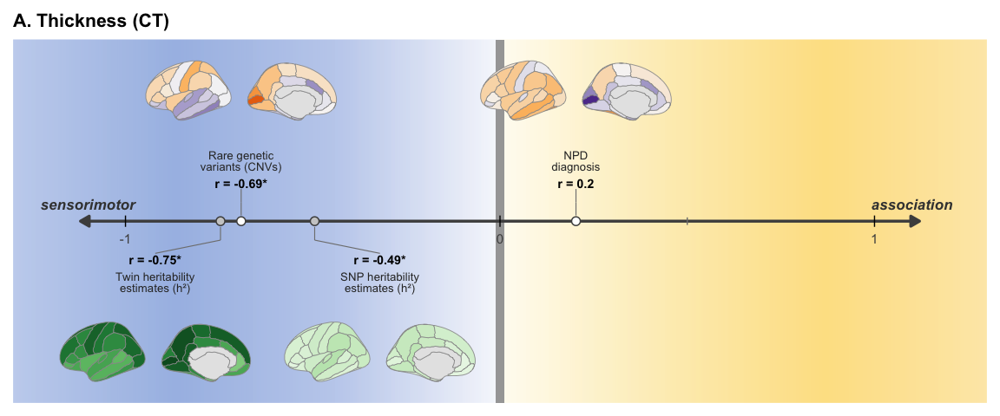
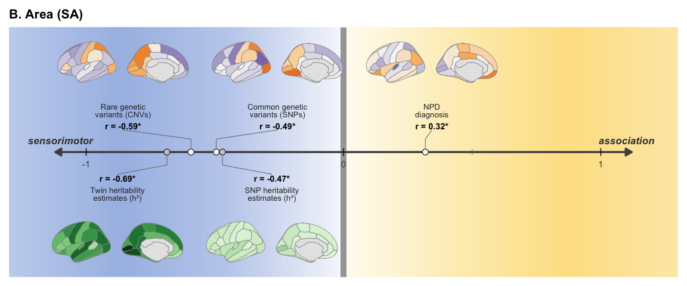
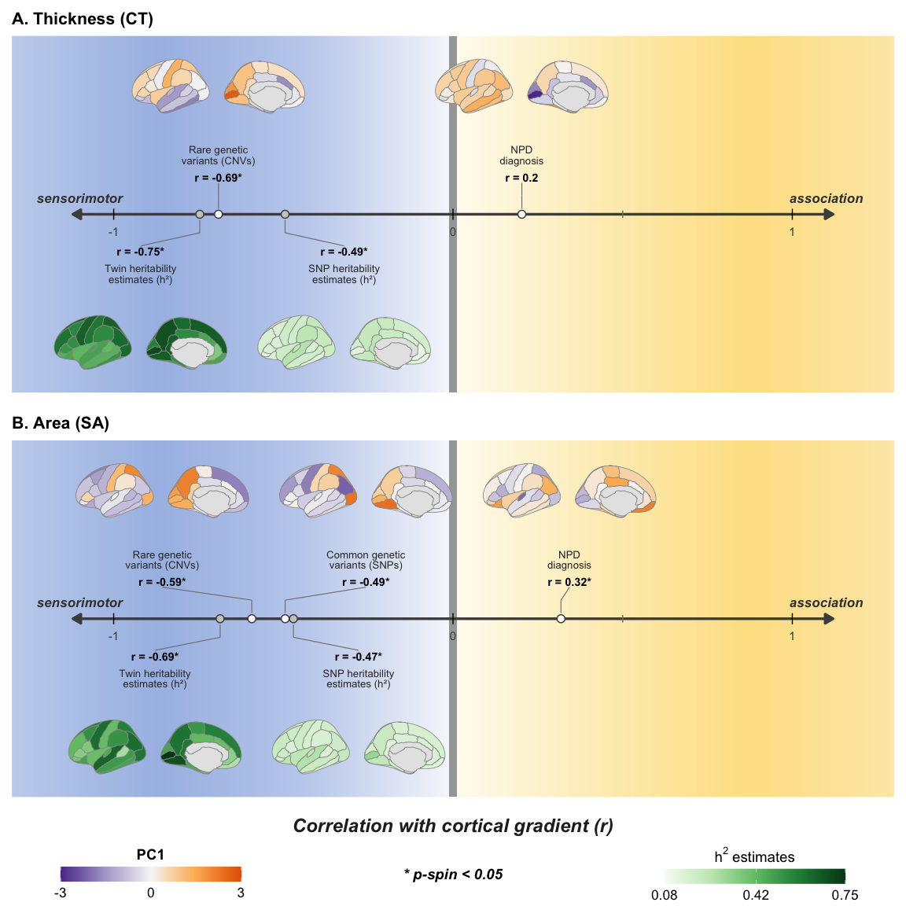

Fig5
================

## Fig. 5, statistics and panel figures A and B

Figure 5. Correlation between the cortical gradient and latent
dimensions of regional cortical differences.

Correlation between the cortical gradient (Pearson’s r) and latent
dimension (PC1) of regional differences / regional heritability
estimates for A) cortical thickness (CT) and B) surface area (SA).
Latent dimension (PC1) profiles were computed for effect sizes across
rare genetic variants (CNVs), common genetic variants (SNPs), and NPDs
for cortical thickness and surface area across 34 Desikan cortical
regions. Regional profiles of twin and SNP heritability estimates for
cortical thickness and surface area across 34 Desikan cortical regions
from Grasby et al. 32. The regional surface area estimates are adjusted
for Total SA. Abbreviations, CT=cortical thickness; h2: heritability;
NPD=neurodevelopmental and psychiatric disorders; PC: principal
component; SA=surface area; SNP: single nucleotide polymorphism; r=
Pearson correlation; \*:spin-permutation significant, p-spin \< 0.05.

## Load data

``` r
source("Rscript_utility_functions.R")
library(cowplot)
library(grid)

## PC1 latent profiles and cortical gradient (-1 x PC1 of AHBA gene expression, abagen)
load(paste0(data_dir, "data_fig5_concensus_profiles_meanAbsES_variance_significance_latentDimPC1.RData"))
df_PC1 = df_concensus_profiles_latentDim_PC1
gradient_map = array_cortical_gradient

## Regional twin and SNP heritability estimates (Grasby et al. 2020)
load(paste0(data_dir, "df_Grasby_h2_regional_RData_file_with_95CI_apr2025.RData"))

## Pre-computed spin rotations (10,000) for the 34 left-hemisphere Desikan regions
load(paste0(data_dir, "df_perm_ids_DesikanLH34_nIterNull_10000.RData"))

## Maps per panel (CT has no SNP PC1 map)
df_CT_input = data.frame(NPDs = df_PC1[, "CT_NPDs"],
                         CNVs = df_PC1[, "CT_CNVs"],
                         SNPs = rep(NA, 34),
                         SNP_h2 = df_Grasby_h2_regional[, "CT_wo_adj_SNP_h2"],
                         Twin_h2 = df_Grasby_h2_regional[, "CT_wo_adj_Twin_h2"])

df_SA_input = data.frame(NPDs = df_PC1[, "SA_NPDs"],
                         CNVs = df_PC1[, "SA_CNVs"],
                         SNPs = df_PC1[, "SA_SNPs"],
                         SNP_h2 = df_Grasby_h2_regional[, "SA_adj_SNP_h2"],
                         Twin_h2 = df_Grasby_h2_regional[, "SA_adj_Twin_h2"])
```

## Stats Fig. 5A and 5B

``` r
## Pearson correlation with the gradient and spin permutation p-value
fCor_pspin_with_gradient = function(df_map_mat, ref_profile, hemi) {
  df_res = data.frame()
  for (map_name in colnames(df_map_mat)) {
    map_data = df_map_mat[, map_name]
    if (all(is.na(map_data))) {
      df_res = rbind(df_res, data.frame(map = map_name, cor = NA, low = NA, high = NA, pspin = NA))
    } else {
      res_test = cor.test(map_data, ref_profile, method = "pearson")
      df_res = rbind(df_res, data.frame(map = map_name,
                                        cor = unname(res_test$estimate),
                                        low = res_test$conf.int[1],
                                        high = res_test$conf.int[2],
                                        pspin = perm.sphere.p(map_data, ref_profile, df_perm_ids_LH)))
    }
  }
  df_res$Hemi = hemi
  return(df_res)
}

df_stats_fig5 = rbind(fCor_pspin_with_gradient(df_CT_input, gradient_map, "CT"),
                      fCor_pspin_with_gradient(df_SA_input, gradient_map, "SA"))
df_stats_fig5$stat_label = ifelse(is.na(df_stats_fig5$cor), NA,
                                  paste0("r = ", round(df_stats_fig5$cor, 2), ifelse(df_stats_fig5$pspin < 0.05, "*", "")))

print(df_stats_fig5)
```

    ##        map        cor         low       high   pspin Hemi stat_label
    ## 1     NPDs  0.2028546 -0.14527683  0.5062896 0.16640   CT    r = 0.2
    ## 2     CNVs -0.6911137 -0.83429542 -0.4605938 0.00055   CT r = -0.69*
    ## 3     SNPs         NA          NA         NA      NA   CT       <NA>
    ## 4   SNP_h2 -0.4948507 -0.71360127 -0.1881744 0.04165   CT r = -0.49*
    ## 5  Twin_h2 -0.7463066 -0.86593239 -0.5459169 0.00095   CT r = -0.75*
    ## 6     NPDs  0.3181815 -0.02239375  0.5925861 0.02310   SA  r = 0.32*
    ## 7     CNVs -0.5928766 -0.77555159 -0.3185840 0.00860   SA r = -0.59*
    ## 8     SNPs -0.4945955 -0.71343537 -0.1878484 0.01100   SA r = -0.49*
    ## 9   SNP_h2 -0.4701798 -0.69745160 -0.1569725 0.00870   SA r = -0.47*
    ## 10 Twin_h2 -0.6862667 -0.83147133 -0.4532990 0.00140   SA r = -0.69*

## Plot functions

``` r
pc1_colors = colorRampPalette(c("#5e3c99", "#b2abd2", "#f7f7f7", "#fdb863", "#e66101"))
h2_colors = colorRampPalette(c("#f7fcf5", "#c7e9c0", "#74c476", "#238b45", "#00441b"))

## Left hemisphere brain map (lateral and medial views)
fBrainPlot_LH = function(array_vals, color_fn, cbar_min, cbar_max) {
  array_vals = pmin(pmax(array_vals, cbar_min), cbar_max)
  df_brain = data.frame(region = names(dk$palette), value = c(array_vals[1:3], NA, array_vals[4:34]))
  p = ggseg(df_brain, atlas = "dk", position = "dispersed", hemisphere = "left",
            mapping = aes(fill = value), colour = "grey60", size = 0.3) +
    scale_fill_gradientn(limits = c(cbar_min, cbar_max), colours = color_fn(100), na.value = "grey90") +
    theme_void() +
    theme(legend.position = "none", plot.margin = margin(0, 0, 0, 0))
  return(ggplotGrob(p))
}

## Spread label positions so that neighbouring brain maps do not overlap
fDodge = function(x, min_gap = 0.6, x_lim = 1) {
  ord = order(x)
  x_disp = x[ord]
  for (iter in 1:50) {
    for (i in seq_along(x_disp)[-1]) {
      if (x_disp[i] - x_disp[i - 1] < min_gap) {
        x_mid = (x_disp[i] + x_disp[i - 1]) / 2
        x_disp[i - 1] = x_mid - min_gap / 2
        x_disp[i] = x_mid + min_gap / 2
      }
    }
    x_disp = pmin(pmax(x_disp, -x_lim), x_lim)
  }
  x_out = x
  x_out[ord] = x_disp
  return(x_out)
}

## Background: sensorimotor (blue) to association (yellow)
background_colours = c(colorRampPalette(c("#c6d4ef", "#a8bee6", "#c3d1ee", "#f7f8fc"))(130),
                       colorRampPalette(c("#fffcf2", "#fdeec0", "#fde293", "#fde9b5"))(130))

## Gradient axis with maps above (PC1) and below (h2) the axis
fGradientAxisPanel = function(in_df_items, list_grobs, y_bottom, y_top) {
  p = ggplot() + theme_void() +
    annotation_raster(matrix(background_colours, nrow = 1), xmin = -1.3, xmax = 1.3,
                      ymin = y_bottom, ymax = y_top, interpolate = TRUE) +
    annotate("rect", xmin = -0.012, xmax = 0.012, ymin = y_bottom, ymax = y_top, fill = "#a6a6a6") +
    annotate("segment", x = -1.12, xend = 1.12, y = 0, yend = 0, linewidth = 1.2, colour = "grey30",
             arrow = arrow(length = unit(0.12, "inches"), type = "closed", ends = "both")) +
    annotate("segment", x = c(-1, -0.5, 0, 0.5, 1), xend = c(-1, -0.5, 0, 0.5, 1),
             y = c(-0.15, -0.1, -0.15, -0.1, -0.15), yend = c(0.15, 0.1, 0.15, 0.1, 0.15),
             colour = c("black", "grey50", "black", "grey50", "black")) +
    annotate("text", x = c(-1, 0, 1), y = -0.45, label = c("-1", "0", "1"), size = 4, colour = "grey30") +
    annotate("text", x = c(-1.1, 1.1), y = 0.45, label = c("sensorimotor", "association"),
             size = 4.5, fontface = "bold.italic", colour = "grey25")
  for (i in seq_len(nrow(in_df_items))) {
    sgn = ifelse(in_df_items$side[i] == "above", 1, -1)
    x_true = in_df_items$r[i]
    x_disp = in_df_items$x_display[i]
    p = p +
      annotate("segment", x = c(x_true, x_true), xend = c(x_true, x_disp), y = sgn * c(0.15, 0.5),
               yend = sgn * c(0.5, 0.85), linewidth = 0.4, colour = "grey50") +
      annotate("point", x = x_true, y = 0, size = 3, shape = 21, fill = ifelse(sgn > 0, "white", "grey80"),
               colour = "grey30", stroke = 0.8) +
      annotate("text", x = x_disp, y = sgn * 1.0, label = in_df_items$stat_label[i], size = 3.8, fontface = "bold") +
      annotate("text", x = x_disp, y = sgn * 1.6, label = in_df_items$label_text[i], size = 3.5,
               colour = "grey20", lineheight = 0.85) +
      annotation_custom(list_grobs[[i]], xmin = x_disp - 0.28, xmax = x_disp + 0.28,
                        ymin = ifelse(sgn > 0, 2.3, -4.6), ymax = ifelse(sgn > 0, 4.6, -2.3))
  }
  p = p + coord_cartesian(xlim = c(-1.3, 1.3), ylim = c(y_bottom, y_top), expand = FALSE, clip = "off") +
    theme(plot.title = element_text(face = "bold", size = 16, hjust = 0, margin = margin(b = 8)),
          plot.margin = margin(4, 4, 4, 4, "mm"))
  return(p)
}

## Colour ranges (shared across panels)
h2_cbar_min = floor(min(c(df_CT_input$SNP_h2, df_CT_input$Twin_h2, df_SA_input$SNP_h2, df_SA_input$Twin_h2)) * 100) / 100
h2_cbar_max = ceiling(max(c(df_CT_input$SNP_h2, df_CT_input$Twin_h2, df_SA_input$SNP_h2, df_SA_input$Twin_h2)) * 100) / 100

label_text = c(NPDs = "NPD\ndiagnosis",
               CNVs = "Rare genetic\nvariants (CNVs)",
               SNPs = "Common genetic\nvariants (SNPs)",
               SNP_h2 = "SNP heritability\nestimates (h²)",
               Twin_h2 = "Twin heritability\nestimates (h²)")

## One panel: PC1 maps (z-scored for display) above the axis, h2 maps below
fPanelFig5 = function(df_input, hemi) {
  in_df_items = df_stats_fig5[df_stats_fig5$Hemi == hemi & !is.na(df_stats_fig5$cor), ]
  in_df_items$r = in_df_items$cor
  in_df_items$label_text = label_text[in_df_items$map]
  in_df_items$side = ifelse(in_df_items$map %in% c("SNP_h2", "Twin_h2"), "below", "above")
  in_df_items$x_display = NA
  for (s in c("above", "below")) {
    idx = which(in_df_items$side == s)
    in_df_items$x_display[idx] = fDodge(in_df_items$r[idx])
  }
  list_grobs = list()
  for (i in seq_len(nrow(in_df_items))) {
    map_name = in_df_items$map[i]
    if (in_df_items$side[i] == "above") {
      list_grobs[[i]] = fBrainPlot_LH(scale(df_input[, map_name])[, 1], pc1_colors, -3, 3)
    } else {
      list_grobs[[i]] = fBrainPlot_LH(df_input[, map_name], h2_colors, h2_cbar_min, h2_cbar_max)
    }
  }
  return(fGradientAxisPanel(in_df_items, list_grobs, y_bottom = -4.8, y_top = 4.8))
}

## Colour bar legends
fColorbar = function(color_fn, cbar_min, cbar_max, cbar_breaks, title_text) {
  df_dummy = data.frame(x = 1:100, val = seq(cbar_min, cbar_max, length.out = 100))
  p = ggplot(df_dummy, aes(x = x, y = 1, fill = val)) +
    geom_tile() +
    scale_fill_gradientn(colours = color_fn(100), limits = c(cbar_min, cbar_max), breaks = cbar_breaks) +
    theme_void() +
    theme(legend.position = "bottom", legend.title = element_text(size = 14, face = "bold"),
          legend.text = element_text(size = 13)) +
    guides(fill = guide_colourbar(title = title_text, title.position = "top", title.hjust = 0.5,
                                  barwidth = 12, barheight = 1))
  return(get_legend(p))
}
```

## Plot Fig. 5A: CT

``` r
p_fig5A = fPanelFig5(df_CT_input, "CT") + ggtitle("A. Thickness (CT)")
print(p_fig5A)
```

<!-- -->

``` r
save_panel(p_fig5A, "Fig5A", 12, 5)
```

## Plot Fig. 5B: SA

``` r
p_fig5B = fPanelFig5(df_SA_input, "SA") + ggtitle("B. Area (SA)")
print(p_fig5B)
```

<!-- -->

``` r
save_panel(p_fig5B, "Fig5B", 12, 5)
```

## Plot Fig. 5: composite

``` r
axis_title = textGrob("Correlation with cortical gradient (r)", gp = gpar(fontsize = 18, fontface = "bold.italic", col = "grey15"))
legend_row = plot_grid(fColorbar(pc1_colors, -3, 3, c(-3, 0, 3), "PC1"),
                       textGrob("* p-spin < 0.05", gp = gpar(fontsize = 14, fontface = "bold.italic")),
                       fColorbar(h2_colors, h2_cbar_min, h2_cbar_max,
                                 round(seq(h2_cbar_min, h2_cbar_max, length.out = 3), 2), expression(h^2 ~ "estimates")),
                       ncol = 3)
p_fig5 = plot_grid(p_fig5A, p_fig5B, axis_title, legend_row, ncol = 1, rel_heights = c(1, 1, 0.08, 0.16))
print(p_fig5)
```

<!-- -->

``` r
save_panel(p_fig5, "Fig5", 12, 12)
```

## Save source data

``` r
for (hemi in c("CT", "SA")) {
  df_input = if (hemi == "CT") df_CT_input else df_SA_input
  df_stats = df_stats_fig5[df_stats_fig5$Hemi == hemi, c("Hemi", "map", "cor", "low", "high", "pspin", "stat_label")]
  colnames(df_stats) = c("metric", "map", "r", "r_95CI_low", "r_95CI_high", "p_spin", "label")
  df_regional = data.frame(region = rep(rois_desikan, ncol(df_input)),
                           map = rep(colnames(df_input), each = 34),
                           value = unlist(df_input, use.names = FALSE),
                           cortical_gradient = rep(gradient_map, ncol(df_input)))
  df_regional = df_regional[!is.na(df_regional$value), ]
  save_source_data(df_stats, paste0("Fig5", ifelse(hemi == "CT", "A", "B")))
  save_source_data(df_regional, paste0("Fig5", ifelse(hemi == "CT", "A", "B"), "_regional"))
}
```
